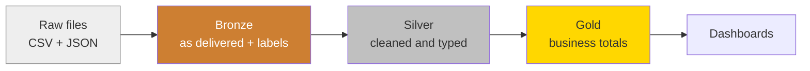
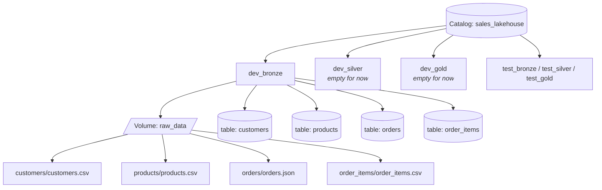
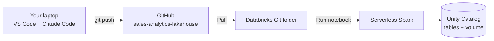
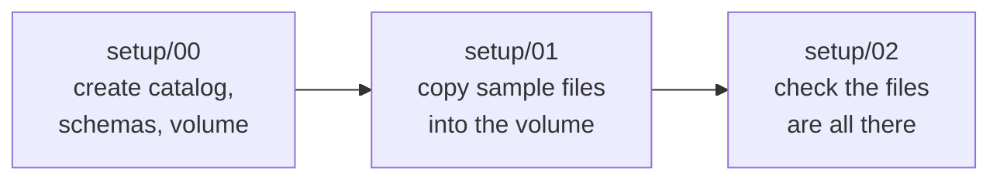
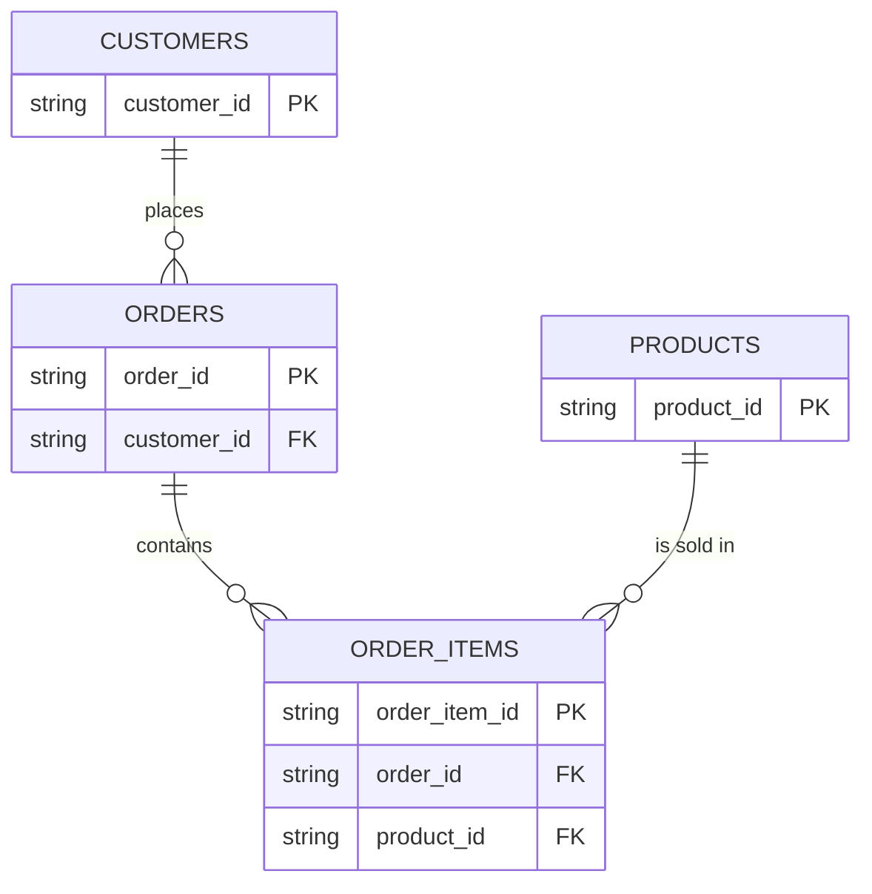
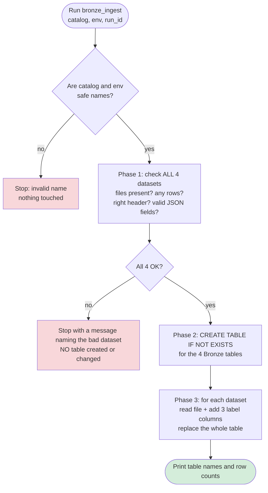
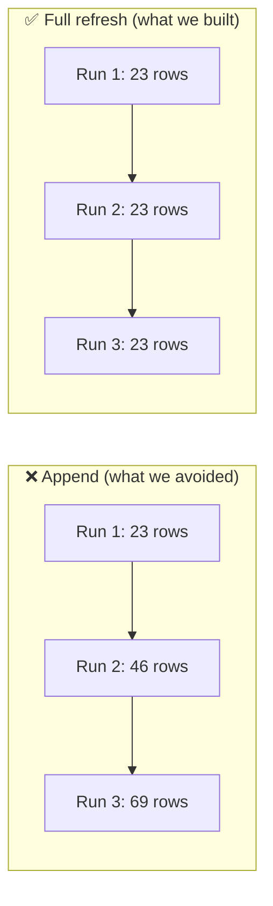
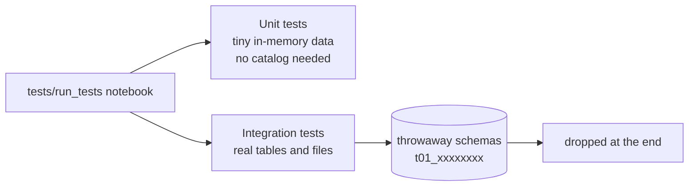
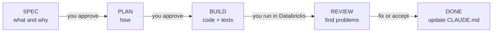

# Learning guide: what we built, why, and how

This guide explains steps 01 and 02 of the Sales Analytics Lakehouse in plain
language. Read it top to bottom once. Then do the **"Try it yourself"**
exercises in Databricks. Running things yourself is how this sticks.

> The diagrams are written in Mermaid. They render on GitHub and in VS Code
> (with a Mermaid extension).

---

## 1. The big picture in one minute

We are building a small **data pipeline**. Raw sales files go in at one end,
and clean, analysis-ready tables come out at the other.

Think of a restaurant kitchen:

| Kitchen | Our project | Layer |
|---|---|---|
| Groceries arrive in boxes, some damaged | Raw CSV/JSON files | **Raw files** |
| Groceries put on shelves, *exactly as delivered*, with a delivery label | Bronze tables | **Bronze** ✅ done |
| Washed, peeled, bad items thrown out | Silver tables | **Silver** (next) |
| Finished dishes served to customers | Gold tables / dashboards | **Gold** (later) |

This three-layer idea is called the **Medallion architecture** (Bronze →
Silver → Gold). It is the standard way to organise data in Databricks.



**Why not clean the data straight away?** If Bronze keeps a perfect copy of
what arrived, you can always go back to it. When a cleaning rule turns out to
be wrong, you fix the rule and rebuild Silver from Bronze. You never have to
ask anyone to resend the files.

---

## 2. Databricks words you need, explained simply

| Word | What it really is | Where we used it |
|---|---|---|
| **Workspace** | Your Databricks "desktop" where notebooks and folders live | Everything |
| **Git folder** | A workspace folder linked to GitHub. You click **Pull** to get the latest code | How our code reaches Databricks |
| **Notebook** | A page of code cells you run one by one | `setup/00…`, `notebooks/bronze_ingest` |
| **Widget** | An input box at the top of a notebook (a parameter) | `catalog`, `env`, `run_id` |
| **Serverless compute** | Databricks starts the machine for you, so there is no cluster to manage | Free Edition runs everything this way |
| **Spark / PySpark** | The engine that processes data across many machines. PySpark is its Python API | Reading files, writing tables |
| **Unity Catalog (UC)** | The "library catalogue" for all data: who owns what, and where it lives | Catalog → schema → table |
| **Catalog** | Top-level folder of data | `sales_lakehouse` |
| **Schema** | A folder inside a catalog (also called a *database*) | `dev_bronze`, `dev_silver`, `dev_gold` |
| **Table** | Rows and columns you can query with SQL | `dev_bronze.customers` |
| **Volume** | A folder for *files* (not tables) inside a schema | `dev_bronze.raw_data` holds our CSV/JSON |
| **Delta table** | A table format that adds **history**, **safe writes** and **time travel** on top of plain files | All Bronze tables |

Unity Catalog's three-level name works like a postal address:

```
sales_lakehouse . dev_bronze . customers
   catalog          schema       table
  (country)         (city)      (street)
```

And this is everything we created:



**Why `dev_` and `test_`?** They are two separate sandboxes. You play in
`dev`, and tests run in their own throwaway schemas. One can never break the
other. This is why the catalog and environment are **parameters (widgets)**
and never typed into the code.

---

## 3. How the code gets from your laptop to Databricks



The rule to remember: **change → commit → push → Pull in Databricks → run.**
If you forget to Pull, Databricks runs the *old* code.

---

## 4. Step 01: the foundation

**Goal:** create the "rooms" (catalog, schemas, volume) and put the raw files
in place. No tables yet.

### The three setup notebooks



| Notebook | What it does | Why it is built this way |
|---|---|---|
| `00_setup_catalog_objects` | `CREATE CATALOG / SCHEMA / VOLUME IF NOT EXISTS` | `IF NOT EXISTS` makes it **safe to run again**. A second run changes nothing |
| `01_load_sample_data` | Empties each dataset folder, then copies the file in | Empty-then-copy means a re-run **replaces** files instead of piling up copies |
| `02_verify_raw_data` | Reads each file and checks row counts and columns | Catches a missing or broken file *before* anything uses it |

When we ran `00`, Databricks Free Edition **allowed** us to create our own
catalog (`sales_lakehouse`). If it hadn't, the notebook would have stopped
and told you to use `catalog=workspace`. We chose "stop and tell" over
"silently switch", so you always know where your data goes.

### The sample data

Four small, made-up datasets (fake names, `example.com` emails):



| Dataset | Format | Rows |
|---|---|---|
| customers | CSV | 23 |
| products | CSV | 15 |
| orders | JSON (one record per line) | 41 |
| order_items | CSV | 90 |

### The 10 deliberately "dirty" records

Real data is messy, so we planted problems on purpose. Silver will have to
deal with each one. Here they are:

| Problem type | Example in our data | Simple meaning |
|---|---|---|
| Null key | a customer with no `customer_id` | Row has no ID |
| Exact duplicate | `C007` twice, `O0010` twice | Same row sent twice |
| Changed record | `C012` twice with a new email and city | Customer updated their details |
| Malformed value | price `abc`, date `2024-04-31` | Not a real number or date |
| Invalid value | quantity `0` | Valid number, but impossible for a sale |
| Orphan reference | order for customer `C999`, item for product `P999` | Points to something that doesn't exist |

The full list is in `docs/data_dictionary.md`.

### Why we read every column as text (STRING)

If we told Spark "price is a number" while reading, it would quietly turn
`abc` into `NULL`, and we would **lose the evidence** that the price was
broken. Reading everything as text keeps the raw value exactly. Converting
to the right types is Silver's job.

---

## 5. Step 02: Bronze ingestion

**Goal:** copy the four raw files into four **Delta tables**, exactly as
delivered, plus three "delivery label" columns.

### The three label (metadata) columns

| Column | Example | Answers the question |
|---|---|---|
| `_ingested_at` | `2026-10-08 14:03:11` | *When* did this row arrive? |
| `_source_file` | `/Volumes/.../customers/customers.csv` | *Which file* did it come from? |
| `_run_id` | `ec3fad97d3254041…` | *Which run* loaded it? (the same across all 4 tables) |

The leading `_` marks them as "added by the pipeline, not from the source".

### What one run of `notebooks/bronze_ingest` does



### Idea 1: "All or nothing"

We check **all four** datasets before writing **anything**. If just one is
bad, nothing changes. Otherwise you could end up with fresh customers but
stale orders, which is confusing and hard to spot.

Things that make a run stop: a missing folder, an empty file, a wrong CSV
header, a CSV line with too many or too few fields, or a JSON record with
missing or extra fields.

### Idea 2: "Full refresh" = safe to re-run (idempotent)

**Idempotent** means running it twice gives the same result as running it
once. Each run **replaces** the whole table with the current files, so rows
are never doubled.



Other ways exist (`COPY INTO` and Auto Loader only load *new* files). They
are more advanced, so they are left for a later step.

### Idea 3: Delta history and time travel

Even though each run replaces the table, **Delta keeps the old versions**.
You saw this yourself:

```
version 0  CREATE TABLE
version 1  WRITE   ← your 1st run
version 2  WRITE   ← 2nd run
version 3  WRITE   ← 3rd run
```

So if a bad run ever wipes good data, you can look at or restore an older
version. Plain CSV files can't do that.

### Idea 4: Create the tables only after the checks pass

The `CREATE TABLE` code lives in `src/sales_lakehouse/bronze.py` and runs
*inside* ingestion, after the checks. That way a failed run never leaves
behind empty half-made tables.

---

## 6. The safety habits we used (and why)

| Habit | What it means | Why it matters |
|---|---|---|
| **Parameters, not hard-coding** | catalog and env come from widgets | Same code runs for dev, test, and later a Job |
| **Validate names** | Only letters, digits and `_` are allowed in catalog/env | Stops **SQL injection**, e.g. `env = "x; DROP SCHEMA …"` |
| **Re-runnable everything** | `IF NOT EXISTS`, empty-then-copy, full refresh | A re-run or retry never breaks or doubles anything |
| **Explicit schemas** | We declare columns instead of letting Spark guess | Guessing can change silently when the data changes |
| **Logic in functions, notebooks just call them** | `src/` holds the code, notebooks are thin | Functions can be tested; notebook cells can't easily be |

---

## 7. How we tested



- **Unit tests** check one function with a few hand-made rows. They are fast.
- **Integration tests** run the real thing (setup → load → ingest) in
  **throwaway** schemas named `t01_<random>`, then delete them. That's why
  `SHOW SCHEMAS … LIKE 't01_*'` should return nothing.
- Tests come from the spec's **acceptance criteria** (AC-1, AC-2, …), not
  from the code. A test written by reading the code just repeats the code's
  mistakes.
- Final score: **59 tests, all green**.

### Bugs the process caught (real lessons)

| What happened | Lesson |
|---|---|
| `OSError: [Errno 29] Illegal seek` | Files in a UC **volume** can't be opened in *append* mode. Read the file and rewrite it instead |
| Review found that an **empty file** would wipe a good Bronze table | "Missing" isn't the only danger. "Present but empty" is too. Validation now rejects 0-row files |
| The catalog could be created on Free Edition | We designed for both outcomes (create or stop) and learned the real answer by running it |

---

## 8. The workflow we followed: Spec → Plan → Build → Review → Done



| Stage | Question it answers | Our step 02 example |
|---|---|---|
| Spec | *What* do we want, and how do we know it works? | "A re-run must not duplicate rows" (AC-4) |
| Plan | *How* will we do it? | "Use full refresh with `writeTo().overwrite()`" |
| Build | Write the code and tests, then run them | 28 new tests |
| Review | What could still go wrong? | Found the empty-file problem (Q-1) |
| Done | Record what we learned | CLAUDE.md "Architecture" section |

This is how real teams avoid "vibe coding": every decision is written down
with its reason.

---

## 9. Code map: where to look

```
src/sales_lakehouse/
  naming.py         ← safe names: dev → dev_bronze, dev_silver, … (start here, it's short)
  setup_ddl.py      ← CREATE CATALOG / SCHEMA / VOLUME statements
  raw_datasets.py   ← the 4 datasets: columns, file names, loading, checking
  bronze.py         ← Bronze tables + the ingest_bronze() function
setup/              ← notebooks 00, 01, 02 (run once per environment)
notebooks/          ← bronze_ingest (the pipeline)
tests/              ← run_tests notebook + test files
data/sample/        ← the 4 raw files
docs/               ← data dictionary + this guide
```

**Suggested reading order:** `naming.py` → `setup_ddl.py` →
`setup/00_setup_catalog_objects.py` → `raw_datasets.py` → `bronze.py` →
`notebooks/bronze_ingest.py`.

---

## 10. Try it yourself (in the Databricks SQL editor)

Run these one by one and think about the result. This is where the learning
happens.

**1. Look at Bronze data**
```sql
SELECT * FROM sales_lakehouse.dev_bronze.customers;
```
*Find the row with no `customer_id`. Find both `C012` rows: what changed?*

**2. Find the dirty records yourself**
```sql
-- duplicates
SELECT customer_id, COUNT(*) AS n
FROM sales_lakehouse.dev_bronze.customers
GROUP BY customer_id HAVING COUNT(*) > 1;

-- orphan orders (customer doesn't exist)
SELECT o.order_id, o.customer_id
FROM sales_lakehouse.dev_bronze.orders o
LEFT JOIN sales_lakehouse.dev_bronze.customers c ON o.customer_id = c.customer_id
WHERE c.customer_id IS NULL;

-- prices that are not numbers
SELECT * FROM sales_lakehouse.dev_bronze.products
WHERE try_cast(unit_price AS DECIMAL(10,2)) IS NULL;
```

**3. See the delivery labels**
```sql
SELECT DISTINCT _run_id, _ingested_at, _source_file
FROM sales_lakehouse.dev_bronze.orders;
```

**4. Delta history and time travel**
```sql
DESCRIBE HISTORY sales_lakehouse.dev_bronze.customers;

SELECT _run_id, COUNT(*) FROM sales_lakehouse.dev_bronze.customers VERSION AS OF 1
GROUP BY _run_id;
```
*Compare the `_run_id` at version 1 with the current one.*

**5. See the volume files**
```sql
LIST '/Volumes/sales_lakehouse/dev_bronze/raw_data/customers/';
```

**6. Prove idempotency yourself:** run `notebooks/bronze_ingest` again, then
re-run query 1. The row count stays 23, and only the `_run_id` changes.

---

## 11. Quick self-check

<details><summary>1. What are Bronze, Silver and Gold, in one line each?</summary>
Bronze = raw data as delivered plus labels. Silver = cleaned, typed and
deduplicated. Gold = business-level summaries for reports.
</details>

<details><summary>2. What is the difference between a volume and a table?</summary>
A volume stores <b>files</b> (our CSV/JSON). A table stores <b>rows and columns</b> you query with SQL.
</details>

<details><summary>3. Why are all Bronze data columns STRING?</summary>
So bad values like <code>abc</code> are kept exactly, instead of silently
becoming NULL. Typing happens in Silver.
</details>

<details><summary>4. What does "idempotent" mean, and how did we achieve it?</summary>
Running it again gives the same result. We used <code>IF NOT EXISTS</code>,
empty-then-copy for files, and full refresh for tables.
</details>

<details><summary>5. Why check all 4 datasets before writing anything?</summary>
So a bad file never leaves you with some tables new and some old. It's all
or nothing.
</details>

<details><summary>6. If a bad run wiped a Bronze table, how could you recover?</summary>
Delta history: read an older version with <code>VERSION AS OF</code> (or
<code>RESTORE</code> the table). Or simply re-run ingestion from the raw files.
</details>

<details><summary>7. Why are catalog and env widgets instead of written in the code?</summary>
So the same code runs for dev, test and later Jobs without editing, and
tests can never touch your dev data.
</details>

---

**Next step (03 — Silver):** turn Bronze's messy text into clean, typed,
deduplicated tables, deciding what to do with each of the 10 dirty records.
